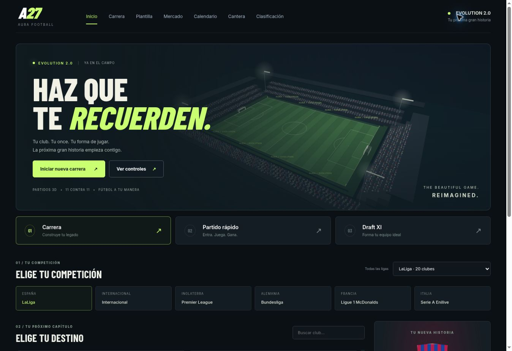

# AURA / Next Season 3.0

Fútbol de navegador con partidos 3D de once contra once, modo carrera, plantilla editable, negociaciones por etapas y Draft XI gratuito. Next Season 3.0 renueva los menús y añade gestión durante el partido, desarrollo de futbolistas, objetivos de directiva y una red de ojeadores.

## Novedades de Next Season

- **Presentación:** nueva identidad grafito, naranja y lima, estadio 3D en el inicio, progreso de temporada y resumen de confianza directiva. Diseño adaptable a móvil.
- **Partidos:** pases que valoran dirección, espacios y líneas de intercepción; desmarques del receptor; coberturas defensivas y porteros que anticipan la trayectoria. La presión rival y la fatiga afectan a los tiros.
- **Plan de partido:** pausa con P, Escape o el botón en pantalla. Cambia entre equilibrado, posesión, presión alta y contraataque; realiza hasta cinco sustituciones. Un jugador sustituido no puede regresar. Los cambios respetan la energía, el puesto y el rendimiento efectivo del futbolista.
- **Desarrollo:** tres sesiones por jornada, una por jugador. Equilibrado entrega 25 EXP y consume 6 de energía; intensivo entrega 40 EXP y consume 12; recuperación devuelve 12 de energía. Cada 100 EXP suma un punto de GRL hasta el potencial. Las sesiones se renuevan tras disputar o simular una jornada.
- **Directiva:** tres objetivos de temporada con recompensas que solo se reciben una vez: victorias, desarrollo e incorporación de un juvenil. La confianza es un indicador informativo; no hay despidos.
- **Ojeadores:** rutas de Ecuador, España y Brasil. Un informe por jornada con tres juveniles ficticios identificados como cantera generada. Máximo dos incorporaciones por temporada; se valida presupuesto, límite de 28 jugadores y margen salarial. El informe nuevo reemplaza al anterior.



## Jugar

Abre `index.html` o sirve el repositorio en tu Codespace con `python3 -m http.server 8000` y abre el puerto 8000. No necesitas instalar paquetes para jugar: el motor gráfico y el catálogo están incluidos. Los retratos opcionales siguen dependiendo de un proveedor externo.

- **Carrera:** selecciona competición y club. **Jugar partido 3D** disputa tu siguiente jornada; **Simular jornada** calcula los resultados inmediatamente.
- **Partido rápido:** elige dos equipos y juega contra la IA.
- **Draft XI:** elige uno de cinco futbolistas por posición, completa once jugadores distintos y juega un amistoso contra Real Madrid. Sin monedas, compras ni premios de pago.

La carrera permanece en memoria durante la sesión. Recargar siempre vuelve a **Iniciar nueva carrera**, sin leer ni escribir `localStorage`.

## Controles

| Acción | Teclado | Mando estándar |
| --- | --- | --- |
| Mover | WASD o flechas | Stick izquierdo |
| Disparar | Mantener y soltar J | B / círculo |
| Pase | K | A / cruz |
| Pase al espacio | L | Y / triángulo |
| Entrada | Espacio | X / cuadrado |
| Cambiar jugador | E | LB / L1 |
| Sprint | Shift | RB / R1 |
| Cambiar cámara | C | Botón en pantalla |
| Pausa | P o Escape | Start / Options |

En pantalla táctil aparecen un joystick y botones. El equipo dirigido ataca hacia la derecha en la primera parte y hacia la izquierda en la segunda. Hay tres cámaras: transmisión, amplia y táctica.

Antes de jugar puedes elegir 2, 3, 5 u 8 minutos de duración total, tres dificultades, noche/atardecer/día y tres calidades gráficas. El reloj transforma esa duración en 90 minutos de fútbol. El descanso, las celebraciones y la pausa no consumen tiempo de partido.

## Partidos y gráficos

`match-engine.js` separa la simulación de los gráficos. Incluye 22 futbolistas, movimiento con energía, balón, pases, tiros con potencia, entradas, porteros, reinicios al salir el balón, goles, cambio de campo y estadísticas.

`match-graphics.js` utiliza **Three.js / WebGL**, incluido localmente bajo licencia MIT. El estadio, las gradas, los espectadores, las redes, los modelos y las texturas son geometría y dibujos originales generados por código. Los jugadores son estilizados; las insignias son representaciones originales, no escudos oficiales.

`software-graphics.js` dibuja el mismo partido con proyección 3D sobre Canvas 2D cuando WebGL está desactivado. Se indica **3D compatible · sin aceleración gráfica** dentro del partido.

Esta actualización **no utiliza Unreal Engine**. Unreal no estaba instalado en el entorno. Una aplicación Unreal para navegador necesita una compilación nativa e infraestructura de Pixel Streaming; no se activa añadiendo una dependencia al HTML. No se han contratado servidores ni creado cuentas.

El fútbol es arcade: no hay fuera de juego, faltas, penaltis, tarjetas ni lesiones. No hay multijugador en línea ni animaciones de un juego comercial.

## Carrera, plantilla y mercado

- Cinco formaciones, once editable por selección o arrastre, suplentes, capitán y selección automática por posición. Los partidos 3D usan ese once y sus posiciones de partida.
- Moral, energía, roles, contratos, salarios y apariciones. Tanto los titulares como quienes entran durante un partido jugado reciben una aparición. La simulación y el partido 3D utilizan el rendimiento efectivo del once.
- Cuatro estilos de movimiento para tus compañeros en 3D: equilibrado, posesión, presión y contraataque.
- Fichajes: consulta → acuerdo con el club → contrato con el agente → firma. Incluye contraofertas, tensión, ventas, renovaciones y ofertas rivales al avanzar jornadas.
- El presupuesto cambia solo al confirmar una firma, después de validar dinero, propiedad, capacidad y tope salarial. Las llamadas pausadas se pueden retomar.
- El resultado jugado sustituye únicamente el marcador del encuentro del usuario; los demás se simulan. Se mantiene la orientación local/visitante del calendario.
- Salir sin resultado no avanza la jornada ni entrega ingresos. Un mismo resultado no puede confirmarse dos veces.

Reglas de contratos: [docs/career-management.md](docs/career-management.md). Los salarios actúan como tope de contratación, sin descuento semanal automático.

## Datos y alcance

La instantánea ampliada incluida acepta **19.423 jugadores, 739 clubes y 49 agrupaciones de competición**. Conserva además LaLiga y la exhibición originales. Algunas agrupaciones externas tienen cobertura parcial o representan torneos internacionales; todas se juegan con formato de liga de ida y vuelta de AURA.

Fuentes:

- [EA FC ANALYSIS](https://github.com/LakshmiKanth11/EA_FC_ANALYSIS): instantánea declarada del 12 de septiembre de 2026. Se incluyen solo identidad, posición, GRL, club, liga, género, nacimiento y nacionalidad. Es una base de terceros, **no una lista de inscritos oficiales verificada**, y puede contener errores o traspasos desactualizados.
- [FIFA WC2026 Players](https://github.com/matyuschenko/fifa-wc2026-players): 1.248 identidades del Mundial, atribuidas bajo CC BY 4.0. Las posiciones específicas, GRL y precios que ese origen no proporciona son estimaciones originales de AURA. Se normalizan nombres formales conocidos para evitar duplicados.

Se interpretan correctamente cumpleaños ISO y día-mes-año. Los retratos opcionales enlazan a SoFIFA; si faltan se muestran iniciales. No hay caras 3D escaneadas ni licencias oficiales. Presupuestos, salarios, valores y potenciales pertenecen al videojuego. Los calendarios no reproducen las fechas oficiales.

No hay ascensos, descensos, copas con formato oficial ni clasificación continental. Las siguientes temporadas mantienen los participantes de la liga seleccionada. Detalles: [docs/world-catalog.md](docs/world-catalog.md).

## Verificación

Con Node 22 o superior:

```sh
npm test
npm run build
```

Las pruebas verifican partidos, goles válidos, controles del modelo, porteros, pausa, sustituciones, cambio de campo, determinismo, calendarios, plantilla, Draft XI, catálogo sin red, presupuesto, negociaciones, entrenamiento, ojeo y recompensas. El build comprueba sintaxis y reúne solo los archivos de ejecución en `dist/`.

La revisión de navegador usa Canvas 3D cuando el navegador de pruebas tiene WebGL desactivado. La ejecución acelerada debe comprobarse en un dispositivo compatible con WebGL. Licencia de Three.js: [vendor/THREE-LICENSE.txt](vendor/THREE-LICENSE.txt).
