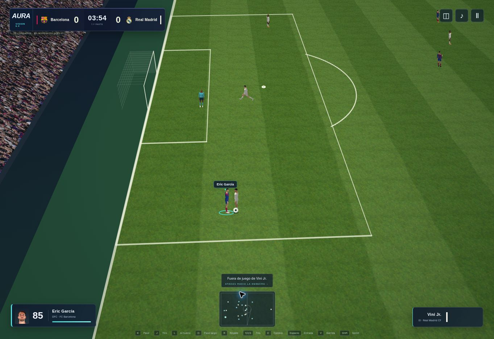

# Revisión del motor de jugadores y materiales

La actualización sustituye el cuerpo construido con esferas y cilindros por una malla humana derivada de los recursos gráficos CC0 de MakeHuman. Se aplican las formas de adulto y musculatura, se adapta la pose de reposo y se agrupan los pesos del esqueleto original en los 17 huesos del partido. El uniforme cubre el modelo con materiales opacos.

La malla compartida contiene 13.660 vértices y 27.228 triángulos; incluye rostro, manos, dedos, orejas, piernas y pies anatómicos. Se mantienen identidades, dorsales y sustituciones. La geometría es una base común; no contiene escaneos ni semejanzas faciales exactas de futbolistas reales.

## Renderizador compatible

El atlas de 16 orientaciones y 12 estados se renderiza a partir de la misma malla y animación. El motor recolorea las prendas, piel y pelo de cada futbolista, dibuja los fotogramas a su escala proyectada, limita la caché y la libera al cerrar el partido. Es una representación por sprites de la geometría 3D para equipos sin WebGL; el campo, cámara, jugadores y balón siguen siendo interactivos. Una imagen estática no sustituye el partido.

El césped usa una textura fotográfica local en una superficie dividida en triángulos con transformación de coordenadas de textura. También se revisa la densidad y escala del público mediante una textura propia. El renderizador WebGL utiliza la malla animada directamente, junto con las nuevas texturas e iluminación ajustada. Las cámaras TV y Tele se acercan; la cámara táctica adapta su altura a pantallas verticales.

## Archivos y procedencia

- `assets/models/footballer-mesh.js`: geometría y pesos empaquetados. Derivada de `makehuman/data/3dobjs/base.obj`, los pesos de `default_weights.mhw` y las formas `caucasian-male-young`, `universal-male-young-averagemuscle-averageweight` y `universal-male-young-maxmuscle-averageweight` del proyecto MakeHuman.
- `assets/models/human-motion.png`: atlas de materiales e iluminación renderizado desde la malla. Generado mediante `scripts/build-human-assets.py`; no es una ilustración de jugabilidad.
- `assets/textures/turf-photo.webp`: textura `examples/textures/terrain/grasslight-big.jpg` del repositorio oficial de Three.js, convertida a WebP para el juego. Se conserva el aviso MIT en `assets/licenses/three-textures-mit.txt`.
- `assets/textures/crowd-photo.webp`: textura de público creada para AURA con generación de imágenes e integrada como material del estadio. La imagen conceptual original no se usa como fondo del partido.
- `assets/licenses/makehuman-cc0.txt`: términos del proyecto de origen que distinguen los recursos gráficos CC0 del código de la aplicación. No se incluye el código de la aplicación MakeHuman.

Fuentes: https://github.com/makehumancommunity/makehuman y https://github.com/mrdoob/three.js . La geometría puede regenerarse con `python scripts/build-human-assets.py /ruta/al/repositorio/makehuman`, con los archivos de origen anteriores disponibles en esa copia.

## Verificación

La suite completa pasa **489 pruebas**. La prueba de escena carga la nueva malla, comprueba sus índices, matrices y pesos, y recorre cuatro calidades y las cámaras. Las nuevas pruebas verifican la geometría empaquetada, estados del atlas, recoloración de camisetas y límite de caché. El empaquetado copia modelos, texturas y licencias junto con el juego.

Se revisó un partido real en el renderizador compatible, con el césped fotográfico y las animaciones nuevas. El navegador de esta sesión no permite WebGL: la compilación de shaders, el aspecto de las sombras y el rendimiento de GPU requieren una prueba en un dispositivo con aceleración 3D. Esta revisión mejora el motor web; no reproduce el fotorealismo ni todos los detalles de la imagen conceptual.

## Captura real

