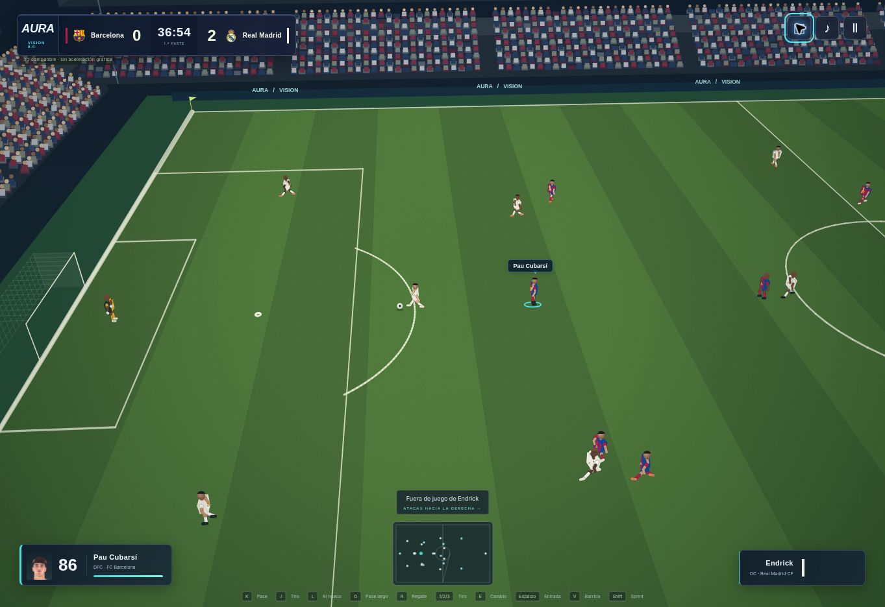

# AURA VISION 9.0

## Cómo activarlo

Abre un partido en cualquiera de los modos que usan el campo 11 contra 11. En «Preparar partido», pulsa **✦ AURA VISION · Máximo** y después **Entrar al estadio**. Selecciona una noche despejada, cámara TV y calidad Ultra. Las preferencias se guardan al entrar. Equilibrado, Alto y Rendimiento siguen disponibles; los ajustes anteriores continúan siendo válidos.

## Cambios implementados

- Césped con bandas de corte, fibras, desgaste en las áreas y mapa de relieve repetido independiente. La textura del terreno llega a 4096 × 2048 en Ultra.
- Líneas de campo trianguladas con grosor de 10,5 cm, círculos, arcos y cuadrantes de córner. Se dibujan juntos en una malla.
- Tres niveles de tribunas escalonadas y público con cabezas y cuerpos separados mediante instancias. El detalle depende del perfil.
- Iluminación de relleno, contraluz y sombras; tonos de día, atardecer y noche, y material de césped mojado con lluvia.
- Futbolistas articulados mediante 17 huesos y una geometría compartida por peinado. Grupos de material para camiseta, pantalón, piel, medias, botas, pelo y detalles. Dorsales y apellidos siguen la identidad, también al sustituir.
- Porterías con postes delgados, malla más fina y deformación tras un gol; balón con paneles negros y sombra de contacto.
- Carteles, banquillos, focos y pantalla del estadio que refleja el marcador.
- Cámara TV y Tele más próximas con seguimiento suave; mayor distancia en pantallas verticales.
- Interfaz compacta azul, cian y violeta, selección de jugador en cian y radar contrastado.
- Resolución adaptativa en WebGL para reducir la carga si los fotogramas se ralentizan. No se promete una tasa fija de imágenes por segundo.
- El balón conserva su orientación cuando el tiempo visual está detenido. Una sustitución retira el modelo anterior y libera sus recursos propios.
- Renderizador compatible con tribunas más densas, nuevas proporciones de uniformes, iluminación del césped y el mismo encuadre y estilo de interfaz.
- Entradas de escritorio y móvil sincronizadas, con URLs de recursos versionadas para la actualización.

El motor de reglas, partidos, controles, resultados, monedas y guardados existentes permanece integrado. Esta revisión cambia el renderizado y la presentación; no sustituye el juego por una imagen.

## Validación y alcance

`npm test`: **486 pruebas correctas**. `npm run build`: **760 archivos de ejecución** preparados. La suite construye la escena WebGL en cuatro calidades, comprueba matrices y pesos de los esqueletos, geometría finita, retirada del modelo sustituido y congelación del giro del balón. También cubre cámaras, controles, sustituciones, repeticiones y guardados existentes. La construcción de escenas usa un renderer de prueba, no una GPU real.

La revisión visual y de interacción en navegador utilizó el modo compatible porque WebGL está desactivado en ese entorno. Se observó un partido en marcha, pases, goles, cambio de cámara, repetición y pausa. La apariencia visual en WebGL, su compilación de shaders y el rendimiento real de Ultra quedan pendientes de comprobación en un dispositivo con aceleración gráfica.

Los modelos 3D son originales y procedurales. La imagen conceptual es una referencia estética: esta actualización no reproduce su fotorealismo ni incorpora escaneos de jugadores o activos de EA.

## Captura real del modo compatible

