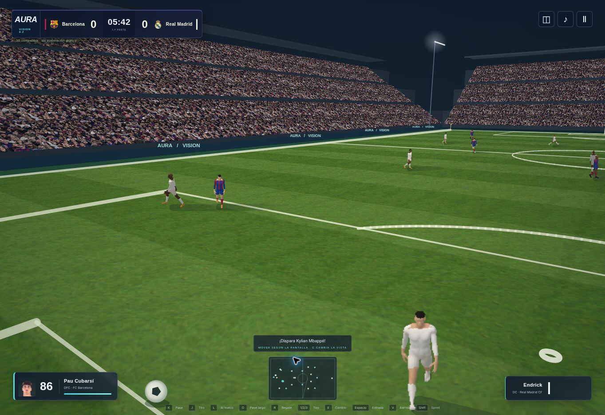

# AURA VISION 9.2 — vista a ras de campo

En «Preparar partido», **⚽ A ras de campo** selecciona calidad Alto y la nueva cámara Campo. **✦ AURA VISION · Máximo** selecciona Ultra con esa misma vista. Pulsa **C** o el botón de cámara durante el partido para recorrer TV, Tele, Panorámica, Táctica y Campo. Los ajustes se conservan en el navegador.

La cámara Campo se sitúa detrás y a un lado del balón, a 4,6 metros de altura en una pantalla horizontal. Su encuadre sigue el balón y se adapta a pantallas verticales y al cambio de campo. El teclado, el joystick táctil y ambos mandos locales mueven y apuntan según la pantalla en esta vista. Las otras cámaras conservan sus controles habituales. El seguimiento y la conversión de los controles usan la misma posición suavizada de cámara.

## Cambios del renderizado

- El modo compatible recorta polígonos, líneas y triángulos de textura contra el plano próximo de la cámara. El terreno continúa por delante del punto de vista sin desaparecer cuando parte de un triángulo queda detrás de él.
- Sombras direccionales y contacto con el césped en el modo compatible, además de luces de estadio con halo. Los sprites del portero giran lateralmente al lanzarse según su orientación en la vista.
- WebGL Alto y Ultra añaden tejido con relieve y escudos disponibles a las camisetas. Las cámaras cercanas muestran briznas geométricas en una región del césped alrededor del balón; Rendimiento y Equilibrado no asumen ese coste. Se reutilizan las geometrías y se libera la escena al salir.
- Ambas entradas, escritorio y móvil, cargan los módulos actualizados con nuevas claves de versión.

## Verificación y alcance

La suite completa pasa **491 pruebas**. El empaquetado prepara **768 archivos de ejecución**. La suite comprueba el encuadre y la conversión de controles en ambas mitades, junto a ambas líneas de meta, las bandas y diferentes proporciones de pantalla. La integración recorre teclado, controles táctiles y dos mandos, tanto en movimiento como al pasar, para detectar conversiones duplicadas. La escena 3D se construye en las cuatro calidades y las seis cámaras, incluida la de repetición. El renderizador compatible recorre esas vistas con las texturas cargadas y con vértices a ambos lados del plano próximo.

Se revisó un partido jugable en el navegador con la nueva cámara y el renderizador compatible. En este entorno WebGL está desactivado: la compilación de shaders, el aspecto de tejido/briznas/escudos con GPU y el rendimiento en dispositivos reales siguen sin verificación visual. Los controles y la geometría WebGL se prueban sin GPU. Esta actualización acerca el encuadre al concepto; no reproduce su fotorealismo ni incorpora semejanzas faciales escaneadas.

